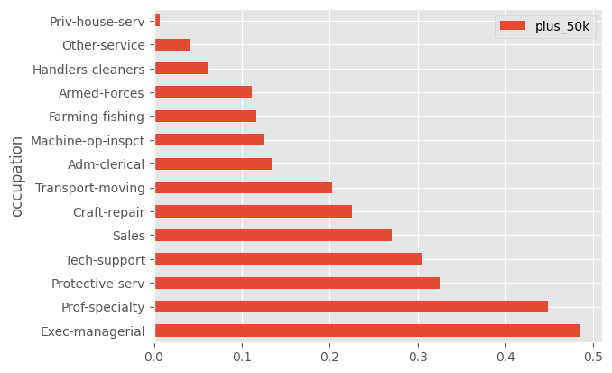

# PySpark Income Classification on the UCI Adult Dataset

Binary classification (income `>50K` vs `<=50K`) built with **Spark SQL, PySpark DataFrames and Spark ML** on Databricks. The notebook compares logistic regression and gradient-boosted trees, tunes both with cross-validation, and inspects feature importance with a random forest.

> Mini-project from the Springboard Data Science bootcamp ("Spark: Databricks Edition"). The exported notebook keeps every cell output, so it renders directly on GitHub.

**Notebook:** [`notebooks/spark_df_sql_ml_exercise.ipynb`](notebooks/spark_df_sql_ml_exercise.ipynb)

---

## Dataset

[UCI Adult (Census Income)](https://archive.ics.uci.edu/dataset/2/adult): demographic and employment attributes for adults, with the target `income` (`>50K` or `<=50K`).

- 14 features (8 categorical, 6 numeric) plus the target
- **30,162 rows** after dropping records with missing values (`?`)
- Positive class (`>50K`) is about **25.2%** of the training split, so the classes are imbalanced
- Split: 70% train / 30% test (`seed=100`): 20,983 train rows and 9,179 test rows

The notebook downloads the data from the UCI repository at run time and saves it as a Delta table named `adult`. No data files are stored in this repo.

## What the notebook covers

1. **Spark SQL**: load the table and aggregate marital-status rates by occupation and education.
2. **DataFrames API**: reproduce the same aggregations with `select`, `when`, `groupBy`, `agg` and `orderBy`.
3. **Explore and visualize**: collect aggregated results into pandas and plot the share earning `>50K` by occupation.
4. **Spark ML pipeline**: `StringIndexer`, `OneHotEncoder` and `VectorAssembler` feed the classifiers.
5. **Models**: `LogisticRegression` and `GBTClassifier`, each trained, evaluated, then tuned with `CrossValidator` (2 folds).
6. **Evaluation**: AUC-ROC, AUC-PR, accuracy, confusion matrix, precision, recall, F1, FPR and TPR.
7. **Feature importance**: logistic regression coefficients, GBT importances and `RandomForestClassifier` importances (50 trees).

### Exercise questions

| # | Task | Section |
|---|------|---------|
| 1 | Spark SQL: highest "never married" rate by education | Spark SQL |
| 2 | Same result with DataFrame operations | Spark DataFrames |
| 3 | Train a `GBTClassifier` (`gbModel`) | GBM - Train |
| 4 | Predict on the test set (`gbPredictions`) | GBM - Predict |
| 5 | Extend `print_performance_metrics()` with F1, precision, recall, FPR, TPR | Logistic Regression - Evaluate |
| 6 | Build a GBT parameter grid (`gbParamGrid`) | GBM - Param Grid |
| 7 | Cross-validate the GBT model and print the best params | GBM - Perform Cross Validation |
| 8 | Table of logistic regression coefficients by feature name | Feature Importance |
| 9 | Train a random forest and print its feature importances | Feature Importance |

## Results

Evaluated on the 9,179-row test set.

| Model | AUC-ROC | AUC-PR | Accuracy | Precision | Recall | F1 |
|-------|:------:|:------:|:--------:|:---------:|:------:|:--:|
| Logistic regression | 0.9052 | 0.7711 | 0.8131 | 0.5776 | 0.8427 | 0.6854 |
| Gradient-boosted trees | 0.9044 | 0.7758 | 0.8524 | 0.7534 | 0.5784 | 0.6544 |
| Logistic regression (cross-validated) | 0.9031 | 0.7584 | 0.8058 | 0.5656 | 0.8458 | 0.6779 |
| **Gradient-boosted trees (cross-validated)** | **0.9215** | **0.8212** | **0.8657** | **0.7972** | 0.5956 | 0.6818 |

**Best parameters from cross-validation**

- Logistic regression: `regParam=0.01`, `elasticNetParam=0.0`, `maxIter=5`
- Gradient-boosted trees: `maxDepth=6`, `maxBins=60`, `maxIter=10`

**Takeaways**

- The cross-validated GBT model is the strongest overall, with the highest AUC-ROC, AUC-PR and accuracy.
- Tuning helped the GBT model but not logistic regression: the tuned logistic model scored slightly lower than the untuned one on test AUC.
- The two model families make different trade-offs. Logistic regression predicts `>50K` whenever the probability exceeds the training positive rate (about 0.25) instead of 0.5, which gives high recall and low precision. The GBT models use the default 0.5 cutoff, which gives higher precision and lower recall. Because thresholds differ, AUC is the fairer comparison; accuracy, precision, recall and F1 move with the cutoff.
- Across the tree models, the strongest signals are marital status or relationship (married), `education_num`, `capital_gain` and `age`:

| Rank | GBT (cross-validated) | Random forest |
|:----:|-----------------------|---------------|
| 1 | Married-civ-spouse (0.262) | Relationship: Husband (0.186) |
| 2 | `capital_gain` (0.189) | Married-civ-spouse (0.144) |
| 3 | `education_num` (0.136) | `education_num` (0.120) |
| 4 | `age` (0.096) | `capital_gain` (0.116) |

- Exploratory finding: executives/managers (48.5%) and professional specialty roles (44.8%) have the highest share earning over 50K; private household service has the lowest (about 0.7%).



*Metric notes: AUC-ROC and AUC-PR use the model's raw prediction scores. Precision, recall and F1 are computed from the confusion matrix at each model's decision threshold. The random forest is used for feature importance only and is not scored on the test set.*

## Repository structure

```
pyspark-adult-income-classification/
├── README.md
├── notebooks/
│   └── spark_df_sql_ml_exercise.ipynb   # Databricks notebook export, with outputs
└── images/
    └── plus_50k_rate_by_occupation.png  # chart used in this README
```

## Running the notebook

1. Create a Databricks workspace (the free tier is enough).
2. In the workspace, choose **Import** and upload `notebooks/spark_df_sql_ml_exercise.ipynb`.
3. Attach it to compute and **Run all**.

Notes:

- Two cells are Databricks-specific, so the notebook will not run unchanged on a plain local Spark install. The data-loading cell writes a **Delta table**, and the cross-validation setup cell creates a **Unity Catalog volume** (`sparkml_tmp`) and points `SPARKML_TEMP_DFS_PATH` at it so Spark ML has a place for temporary files. It needs permission to create volumes in the current catalog and schema.
- The data-loading cell needs internet access to reach the UCI repository.
- Cross-validation trains many models and can take a few minutes.

## Tech stack

Python, PySpark (Spark SQL, DataFrames, Spark ML / MLlib), pandas, matplotlib, Databricks

## Acknowledgements

- Dataset: Becker, B. and Kohavi, R. (1996). *Adult*. UCI Machine Learning Repository.
- The exercise template comes from the Springboard Data Science curriculum. The pipeline code is adapted from a Databricks MLlib binary-classification example.

## Author

Jacob Paul · [LinkedIn](https://www.linkedin.com/in/jacob25paul) · [GitHub](https://github.com/jacob25paul)
